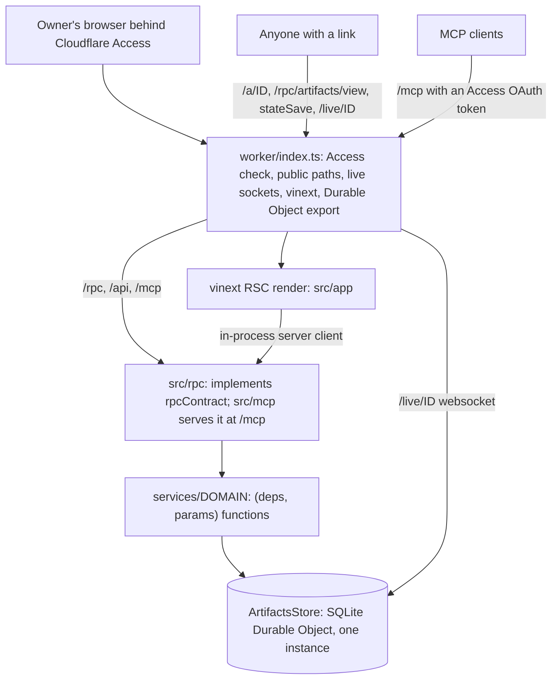
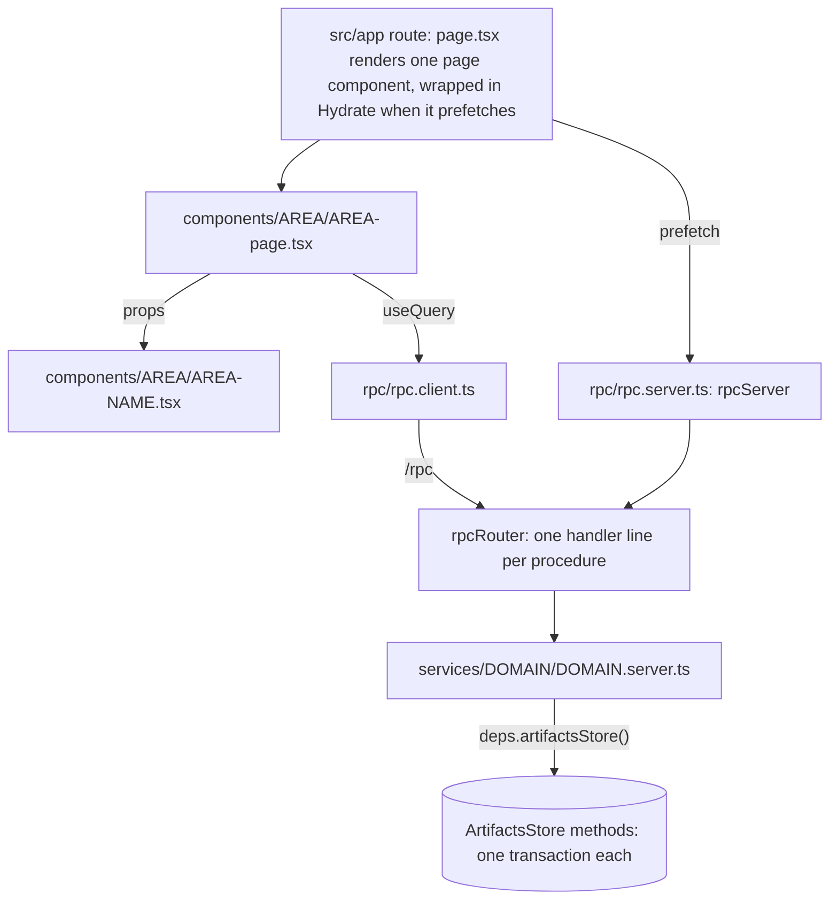

# Architecture

## Rules for this file

1. Agents do not edit this file. Only the user edits it, or an agent the user explicitly allowed for that one change.
2. Drifting from these concepts is forbidden. This file describes the allowed target: code that does not match is fixed in the same change, never written down here.
3. Files and folders that match a pattern listed here are allowed, new domain folders included. A new pattern, file kind, package or concept needs the user's approval first, and its line lands in the same change. README, `.gitignore`, lockfiles and generated files (`worker-configuration.d.ts`, `next-env.d.ts`, `dist/`) are not file kinds.
4. A tree line is a name pattern plus what it holds, in about 15 words.
5. No history, dates, owners, feature behaviour or workflows. The README and skills own those and point to this file.
6. Before writing a file, read a few sibling files of the same kind and follow them.
7. Mermaid labels never contain angle brackets: Mermaid reads them as HTML and drops the text. Diagrams write placeholders in capitals (`services/DOMAIN`).

## 1. How Flaretifacts works

Flaretifacts stores pages that agents publish: blocks specs rendered with json-render, or sandboxed HTML, each with saved state, kept versions and a link. One vinext app (Next App Router on Vite) runs in one Cloudflare Worker. Everything sits behind Cloudflare Access except the artifact links and what they need; one SQLite Durable Object holds every artifact.

### System



### Layers



### Domains

| Domain | Owns |
| --- | --- |
| `artifacts` | artifacts, their versions, saved state, visibility and passcodes, the block catalog, the agent guide, the Durable Object and live updates |
| `examples` | example pages agents start from, listed and fetched by name |
| `users` | who is signed in: the Access identity a request carries |

### Areas

| Area | Route |
| --- | --- |
| `dashboard` | `/`: every artifact in one table |
| `artifacts` | `/a/<id>`: one artifact as its link shows it, with versions for the owner |

`shell`, `hydrate`, `providers`, `errors` and `ui` are app-wide.

### Access

- `worker/index.ts` verifies the Access JWT from the `Cf-Access-Jwt-Assertion` header or the `CF_Authorization` cookie, and turns away a signed-out request unless its path starts with one of `ARTIFACTS.publicPaths`.
- The procedures those paths reach (`artifacts.view`, `artifacts.stateSave`, the `/live/<id>` socket) check the artifact's visibility in the service: public opens for anyone, passcode needs the passcode, private needs a signed-in user.
- `/rpc`, `/api` and `/mcp` put the caller's Access token in `deps.userToken`, so `artifacts.html` renders the page through `SELF` as the same caller.
- A signed-in user is the owner of every artifact. Agents sign in through Access Managed OAuth, or with an Access service token.

### Data loading

- Pages render on the server and hand data to client components through TanStack Query hydration. `Hydrate` creates a server QueryClient per render, awaits `prefetch`, and renders a `HydrationBoundary`.
- Server prefetches use `rpcServer` (TanStack utils over `createRouterClient`, no HTTP), passing the request's user as client context. Client components use `rpc` (`RPCLink` to `/rpc`). Both build keys with `createTanstackQueryUtils` defaults, so hydrated keys match.
- An open artifact page holds a websocket to `/live/<id>`; the Durable Object sends `updated` after every write, and the page refetches.

### Entry files

| File | Runs on | Intent |
| --- | --- | --- |
| `worker/index.ts` | Cloudflare | Worker entry: Access check, public paths, `/live/<id>` sockets, vinext; re-exports `ArtifactsStore` |
| `vite.config.ts` | build | vinext, Cloudflare plugin, Tailwind, icons |
| `src/app/layout.tsx` | Worker | root layout: header, `ProvidersQuery`, toasts |
| `src/app/error.tsx`, `not-found.tsx` | browser, Worker | root error boundary and 404 page |
| `src/app/rpc/[[...rest]]/route.ts` | Worker | oRPC Fetch `RPCHandler` at `/rpc` |
| `src/app/api/[[...rest]]/route.ts` | Worker | oRPC `OpenAPIHandler` at `/api`: REST routes, `/api/openapi.json` and docs at `/api/docs` |
| `src/app/mcp/route.ts` | Worker | MCP Streamable HTTP over the same router |
| `src/app/globals.css` | browser | Tailwind entry and theme tokens |
| `migrations/<nnnn>_<name>.sql` | Durable Object | SQLite schema, applied in order by `ArtifactsStore` on start and recorded in its `migrations` table |

## 2. Naming

Names are locked: a new name follows the row for its kind, and a kind with no row needs the user's approval first (rule 3).

| Kind | File | Export |
| --- | --- | --- |
| Domain functions | `services/<d>/<d>.server.ts` | `<d><Name>`: `artifactsCreate`, `artifactsView` |
| Durable Object | `services/<d>/<d>-store.server.ts` | `<D>Store`: `ArtifactsStore`; sync SQL methods, one transaction per write |
| Pure helpers | `services/<d>/<d>[-<part>].utils.ts` | `<d>[<Part>]<Name>`: `artifactsSpecIssues` |
| Browser modules | `services/<d>/<d>.client.ts` | `<d><Name>`: `artifactsStoreCreate` |
| Agent guide | `services/<d>/<d>-guide.md` | markdown read with `?raw`, returned by `<d>.guide` |
| Example pages | `services/examples/pages/<name>.json` | one example page each (`name`, `title`, `emoji`, `description`, `spec`), loaded with `import.meta.glob` |
| Service constants | `services/<d>/<d>.constants.ts`, at most one | one object `<D>`: `ARTIFACTS`, `USERS` |
| Screen constants | `constants/<topic>.constants.ts` | `<TOPIC>_UI` when `<topic>` is a domain, else `<TOPIC>` (`SHELL`, `MOTION`) |
| Types and schemas | `types/<d>[-<part>].types.ts`; the block catalog is `types/artifacts-blocks.types.ts` | values `<d>[<Part>]…`, inferred types PascalCase |
| Format helpers | `utils/<topic>.utils.ts` | `<topic>…`: `datesFormatTime` |
| Page component | `components/<area>/<area>-page.tsx` | `<Area>Page` |
| Section or part | `components/<area>/<area>-<name>.tsx` | `<Area><Name>` |
| UI primitive | `components/ui/<name>.tsx` | the primitive alone: `Button`, `Table` |
| Migration | `migrations/<nnnn>_<snake_name>.sql` | 4-digit, next number, never renamed once applied |
| Script | `scripts/<name>.ts`, flat | run as `bun scripts/<name>.ts`: `deploy` |
| Test | `tests/<source path>.test.ts` | the source path with `src/` replaced by `tests/` |

- Files are kebab-case and start with their folder's domain or area. Exports start with their file's domain.
- A file past 400 lines is split by sub-concept, never by line count. `types/artifacts.types.ts` holds the block catalog and may exceed it.

### API

| Kind | Rule | Examples |
| --- | --- | --- |
| Procedure key | `rpcContract.<d>.<name>`, `<d>` the domain that owns the write or read | `artifacts.create` |
| Read | a noun: `list`, `get`, `<entity>s` | `artifacts.list`, `artifacts.versions` |
| Write | a verb for the domain's own records, `<entity><Verb>` for a sub-entity | `artifacts.update`, `artifacts.stateSave` |
| Bulk write | input `{ ids }`, output one `{ id, ok, error }` per id | `artifacts.delete` |
| Schemas | `<d><Name>Input` and `<d><Name>Output` | `artifactsCreateInput` |
| Error codes | `<ENTITY>_<STATE>` in `errorsCatalog`, singular entity | `ARTIFACT_NOT_FOUND` |
| Summary | `openapi({ summary })`: one sentence that starts with a verb; MCP uses it as the tool title | `Create an artifact from a blocks spec or an HTML page…` |
| MCP tool | `<d>_<name>`, made by `@orpc/mcp` from the procedure key | `artifacts_create` |

### Storage and bindings

| Kind | Rule |
| --- | --- |
| Bindings | SCREAMING, one per resource: `ARTIFACTS`, `SELF` (this Worker, to render a page for `artifacts.html`) |
| Worker vars | grouped by prefix: `ACCESS_*`, `APP_*`, `DEV_*` |
| Tables and columns | snake_case plural tables (`artifact_versions`), snake_case columns; selects alias camelCase |
| Durable Object instance | one, named `ARTIFACTS.storeName` |

## 3. Project structure

```
src/
├── app/
│   ├── layout.tsx  error.tsx  not-found.tsx  globals.css  page.tsx   root layout, error and 404 pages, Tailwind entry, dashboard
│   ├── a/[id]/page.tsx                                  one artifact's link
│   ├── rpc/[[...rest]]/route.ts                         oRPC handler
│   ├── api/[[...rest]]/route.ts                         OpenAPI handler: REST routes, spec and docs
│   └── mcp/route.ts                                     MCP handler
├── components/
│   ├── <area>/<area>-page.tsx                           the page a route renders
│   ├── <area>/<area>-<name>.tsx                         one section or part, exported as <Area><Name>
│   ├── shell/shell-<name>.tsx                           header and theme toggle
│   ├── hydrate/hydrate.tsx  providers/providers-<name>.tsx  errors/errors-<name>.tsx   server prefetch, client providers, error states
│   └── ui/<name>.tsx  ui/<name>.module.css              Arc UI ports and shadcn primitives
├── core/
│   ├── core.deps.ts                                     the one `deps` instance, built from `cloudflare:workers` env
│   └── core.auth.ts                                     Cloudflare Access JWT check, called only by `worker/index.ts`
├── rpc/
│   ├── rpc.server.ts  rpc-openapi.server.ts  rpc.client.ts   `rpcRouter`, `/rpc` and `/api` handlers, in-process `rpcServer`, browser `rpc`
├── mcp/mcp.server.ts                                    MCP handler over `rpcRouter`, with instructions for agents
├── services/<d>/                                        `<d>.server.ts`, `<d>-store.server.ts`, `<d>.utils.ts`, `<d>.client.ts`, `<d>.constants.ts`, `<d>-guide.md`; `services/examples/pages/` holds the example pages
├── constants/<topic>.constants.ts                      UI-only constants for screens
├── types/<d>.types.ts  rpc.types.ts  errors.types.ts  deps.types.ts  core.types.ts   schemas, the contract, the error catalog, `Deps`, auth
└── utils/<topic>.utils.ts                               pure helpers for a format, no deps or I/O
```

```
./
├── package.json  bun.lock  tsconfig.json  oxlint.config.ts  .fallowrc.json  next.config.ts  vite.config.ts  vitest.config.ts
├── wrangler.jsonc                      bindings, vars and Durable Object migrations; never secrets
├── .github/workflows/ci.yml            manual CI: typecheck, lint, dead code, cycles, tests, build
├── worker-configuration.d.ts           generated by cf-typegen: the global `Env`
├── .dev.vars.example                   Worker values for `bun run dev`
├── AGENTS.md  CLAUDE.md                agent instructions; CLAUDE.md is a link made by agents:sync
├── worker/index.ts                     Cloudflare Worker entry
├── migrations/<nnnn>_<name>.sql        Durable Object SQLite migrations, numbered
├── patches/<package>@<version>.patch   bun patches listed in `patchedDependencies`
├── scripts/<name>.ts                   deploy
├── tests/                              vitest, mirroring src/, worker/ and scripts/; `support/` holds the fake Durable Object and env
└── .agents/                            sync.ts, references/
```

## 4. Standards

- **Fewer files.** Would this fit in an existing file? Use it.
- **Used once, inlined.** A helper with one caller is written inline in that caller. Layer units are not helpers: service functions, procedures, route files, page and section components, named schemas in `types/`, config values in `<d>.constants.ts`.
- **Routes stay thin.** A `page.tsx` renders one page component, wrapped in `Hydrate` when its client components read server data.
- **Procedures stay thin.** Each procedure is `rpc.<d>.<proc>.handler(({ context, input }) => <service>(context, input))`. Inputs, outputs and errors live only in the contract. Procedures have no auth middleware: `worker/index.ts` gates every path, and the public ones check visibility in their service.
- **Headless.** Every action and read a screen needs is a procedure, so agents can do over MCP what the page does.
- **Services.** Functions take `(deps: Deps, params)`. `deps` in `core/core.deps.ts` is built once per isolate; entry points pass it down with the request's user. Services never import it. Tests build deps with `testDepsCreate()`.
- **Durable Object.** `ArtifactsStore` is storage: synchronous SQL methods that each run as one transaction, check the expected version inside it, and tell open sockets what changed. Validation, passcodes and visibility live in the service. Rows leave it parsed by their schema in `types/`.
- **Errors.** One catalog, `errorsCatalog` in `types/errors.types.ts`: a code with its HTTP status, a fixed message and a zod `data` schema. Services throw `errorsCreate(code, data)`; bulk results carry `error: { code, data }`.
- **Components.** One component per file, named function export matching the file. Props are destructured in the signature; props get a `<Name>Props` interface above the component.
- **Types.** Schemas and types live in `types/<d>.types.ts`. Object shapes use `interface`.
- **Styling.** Tailwind on the element. `globals.css` only for what Tailwind cannot express. Arc UI is the source for components.
- **Env.** The Worker reads only its bindings and `vars`. `.dev.vars` holds local values. `process.env` is read only by `vite.config.ts` and `scripts/`.
- **Framework first.** Use what Next, vinext, oRPC, TanStack Query, json-render and Cloudflare already offer before writing your own.

Not allowed: a helper with one caller, default exports where the framework does not require one, markup in `page.tsx`, inline zod schemas in procedures, module-level mutable state, comments other than `SAFETY:` notes in app source, a type assertion without a `SAFETY:` comment, a public path whose procedure does not check visibility.
